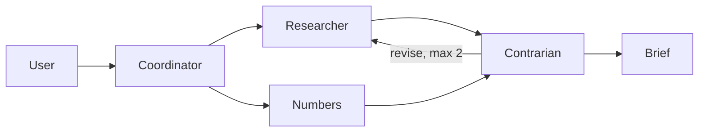

# Google ADK

## What is ADK?

The **Agent Development Kit (ADK)** is Google’s open-source, code-first framework for building, debugging, evaluating, and deploying LLM agents. You define agents, tools, and orchestration in code (Python is the most mature surface; TypeScript, Go, Java, and Kotlin are also supported). ADK is **model-agnostic** through a pluggable LLM interface, but it is **optimized for Gemini** and the Google AI / Vertex stack (grounding, Live API, Agent Engine).

At a high level, an ADK app is a tree or graph of **agents** that call **tools** (your functions, OpenAPI APIs, MCP servers, or other agents via `AgentTool`). The runtime manages **sessions**, **state**, optional **artifacts** (files the agent reads/writes), and **events** you can inspect in the dev UI. ADK 2.0 adds a **workflow runtime**: deterministic routing, parallel fan-out, loops, retries, and **human-in-the-loop** gates on tool execution—not only “let the model decide what to do next.”

Official docs: [adk.dev](https://adk.dev/).

## Similar to other options—and what’s different

Most agent frameworks share the same core loop: model + tools + memory + optional multi-step planning. ADK fits that family alongside **LangGraph / LangChain**, **CrewAI**, **OpenAI Agents SDK**, **Microsoft Semantic Kernel**, and **AutoGen**. If you have used any of those, the mental model transfers: instructions, tool schemas, sub-agents, and session state.

**Where ADK is similar**

- **LangGraph**: Both emphasize **explicit control flow** (graphs, branches, loops) rather than a single opaque ReAct loop. ADK 2.0’s workflow agents and graph runtime are the closest analogue.
- **CrewAI**: Both support **role-specialized agents** and delegation; ADK expresses this with hierarchical agents and `AgentTool` instead of crew “roles” as the primary abstraction.
- **OpenAI Agents SDK**: Both offer a **lightweight SDK** for tool-calling agents with handoffs; ADK goes further on **multi-agent orchestration**, **MCP/A2A**, and **first-party eval + dev UI**.
- **Semantic Kernel / AutoGen**: All target **enterprise-style** multi-agent apps with plugins/tools; ADK’s differentiator is the **Google Cloud deployment path** and **Gemini-native** features (Live, grounding, Agent Engine sandboxes).

**What tends to be unique or strongest in ADK**

- **Google deployment story**: One path from `adk web` locally to **Cloud Run** or **Vertex AI Agent Engine** (`adk deploy agent_engine`), including **persistent code sandboxes** for data/analysis agents.
- **Interoperability as first-class patterns**: **MCP** (`McpToolset`, or expose ADK as an MCP server) and **Agent2Agent (A2A)** (`to_a2a`, remote agents)—useful when agents must talk to tools or other agents outside your process.
- **Sub-agents as tools**: `AgentTool` isolates a child agent’s long tool traces from the parent context (ADK documents this as a way to reduce schema overload and context bloat vs. dumping every MCP tool on one agent).
- **Built-in operator tooling**: **ADK CLI**, **Developer UI** (`adk web`) for stepping through events, and **eval datasets** without wiring a separate harness first.
- **Safety hooks**: **Tool confirmation (HITL)** before sensitive tool calls—handy for “draft then approve” workflows (reviews, incident comms, writes).
- **No-code lane**: **Agent Config** for agents defined without Python, while staying in the same runtime (optional; the projects below are code-first).

**When another stack might be a better default**

- Deep **OpenAI-only** product with minimal orchestration → OpenAI Agents SDK may be enough.
- Existing **LangChain/LangGraph** investment and LangSmith evals → staying in that ecosystem reduces glue.
- **.NET-first** org → Semantic Kernel is often smoother.

**When ADK is a strong default**

- You want **Gemini + Google Cloud** (Search grounding, Maps MCP, Agent Engine code exec, Live voice agents).
- You need **deterministic multi-agent workflows** plus **MCP/A2A** without assembling five libraries yourself.
- You care about **traceability and evals** from day one in a single toolkit.

---

ADK 2.0 is built for controlled multi-agent systems: graph workflows, hierarchical agents, MCP and A2A, human-in-the-loop tool confirmation, session memory, code execution, and a built-in eval runner. The project ideas below are chosen to use that machinery—not generic single-turn chatbots.

A Gemini API key makes live model calls work. Each idea also has a local fallback so it still runs in this environment.

## 1. Briefing Desk (recommended build)

A research desk that will not publish a brief until a contrarian signs off.

- A coordinator routes the question.
- In parallel, a **researcher** (Google Search grounding, or a bundled source corpus when there is no key) and a **numbers** agent (local code execution on figures in the question) draft findings.
- A **contrarian** loops until the brief has citations and a “what would change this” section, capped at two passes.
- The dev UI shows each agent’s trace. A small eval set scores citation presence and refusal to invent sources.

This is the clean ADK demo: built-in search often cannot share an agent with other tools, so the split into sub-agents is the product, not a workaround. `adk web` is the UI.

## 2. Review Council

Paste a diff. Security, tests, and API-design agents run in parallel, then a judge writes one review and drops comments that the others did not support. Tool confirmation gates “post this review.” No GitHub token. Best if you want something you would actually use on your own code.

## 3. Incident War Room

Paste logs or a stack trace. A log reader runs Python over the text, a comms agent drafts a status-page note, and a human must confirm before it is “posted” to a local timeline. Session state keeps the incident channel. Strong HITL and code-execution showcase. Stays on fixtures, no PagerDuty.

## 4. Table GM

A session-backed tabletop: narrator, rules lawyer, and one NPC, with a real dice tool and a world state that survives the session. Most fun, least “enterprise.” Memory and custom tools are the ADK surface.

## 5. A2A studio

Three small agents (researcher, coder, critic) exposed with `to_a2a`, plus a client that calls them as remote agents. Best architecture demo, heaviest to run (several processes) and a weaker first slice.

Skip for this environment: a Gemini Live voice desk. Bidirectional audio is a poor fit for a headless cloud VM.

## What gets built on approval

Briefing Desk only, as one Python ADK app:

- Package layout `adk web` expects (`agent.py`, tools, instructions).
- Coordinator plus researcher, numbers, and contrarian agents.
- Bundled source corpus and a deterministic numbers tool so a run with no API key still returns a traceable brief. Live Gemini and Google Search turn on when `GOOGLE_API_KEY` is set.
- Three eval cases under the ADK eval format (grounded answer, missing-source refusal, numeric check).
- README with `uv` setup, `adk web` on an uncommon port, and how to run evals.
- Dev server left running, with the UI link in the wrap-up.

Stack is Python and the ADK web UI. No extra frontend, database, or Cloud Run deploy.
